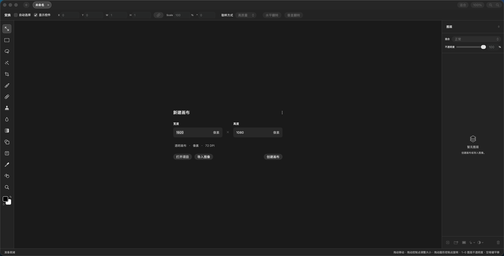

# Compositor macOS 中文发行版

面向 Apple Silicon Mac 的非官方简体中文发行仓库，基于开源图像编辑器
[Compositor](https://github.com/robbietilton/Compositor)，使用 Bilibili
教程中的汉化编译工具生成，并向下兼容至 macOS 12。

> 本项目是社区汉化与兼容构建，不是 Robbie Tilton、Wonder Assembly、Apple
> 或腾讯云的官方发行版，也未获得上述各方背书。

## 下载

前往 [Releases](https://github.com/destinyme58/compositor-macos-zh/releases/latest)
下载：

- `Compositor-v1.5.5-AppleSilicon-zh-Hans-macOS12+.dmg`
- 同版本 `.sha256` 校验文件

## 系统要求

- Apple Silicon（M1/M2/M3/M4 等 arm64）Mac
- macOS 12.0 或更高版本
- 当前构建已在 macOS 15.8.1 上完成启动与画布创建验证

## 版本信息

- 应用版本：Compositor 1.5.5
- 界面语言：简体中文
- 架构：Mach-O arm64
- 最低系统：macOS 12.0
- 编译选项：中文界面 + macOS 12 兼容补丁
- 签名：ad-hoc，未经过 Apple 公证

## 安装

1. 下载 DMG 和 SHA-256 文件。
2. 可选：在终端执行 `shasum -a 256 -c <文件名>.sha256` 校验安装包。
3. 双击 DMG，将 `Compositor.app` 拖入“应用程序”文件夹。
4. 首次启动若被 Gatekeeper 拦截，右键应用选择“打开”，或前往
   “系统设置 → 隐私与安全性”选择“仍要打开”。

发行包使用 ad-hoc 签名，未做 Apple 公证。首次在其他 Mac 上打开时需要手动放行。

## 功能

- Photoshop 风格图层、蒙版、混合模式和图层样式
- 选框、套索、魔棒、裁剪、画笔、文字、渐变和形状工具
- 色阶、曲线、色相/饱和度、Camera Raw 和多种滤镜
- PSD/PSB、JPEG、PNG、HEIC、TIFF、SVG 等格式导入
- 多标签项目、自定义快捷键和 `.comp` 可编辑项目格式

完整功能说明请参阅上游项目 README。

## 自动更新

上游最新版本要求 macOS 26。为避免应用自动升级后在 macOS 12–15 上无法启动，
本发行版建议关闭自动更新。安装验证时已将当前用户的
`SUEnableAutomaticChecks` 设置为 `false`。

## 验证

- `hdiutil verify` 通过
- 安装包 SHA-256 与 Release 附件一致
- 应用架构为 arm64，最低系统为 macOS 12.0
- 已在 macOS 15.8.1 完成中文界面启动和 1920×1080 画布创建

详细记录见 [v1.5.5-macos12 发布说明](docs/releases/v1.5.5-macos12.md)。

## 来源与许可

- 上游源码：https://github.com/robbietilton/Compositor
- 汉化来源与工具：https://ps.vumstar.com:5082/
- 教程视频：https://www.bilibili.com/video/BV1KFWA65EgW/
- 原始中文移植参考：https://github.com/J6meTime/Compositor

Compositor 采用 MIT 许可证，许可证原文见 [LICENSE](LICENSE)。修改与再分发记录见
[ATTRIBUTION.md](ATTRIBUTION.md)。

